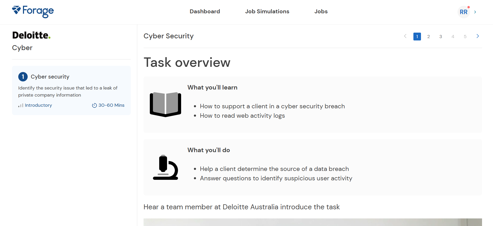
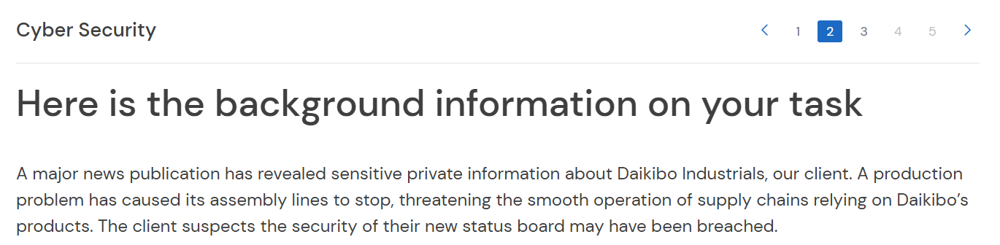
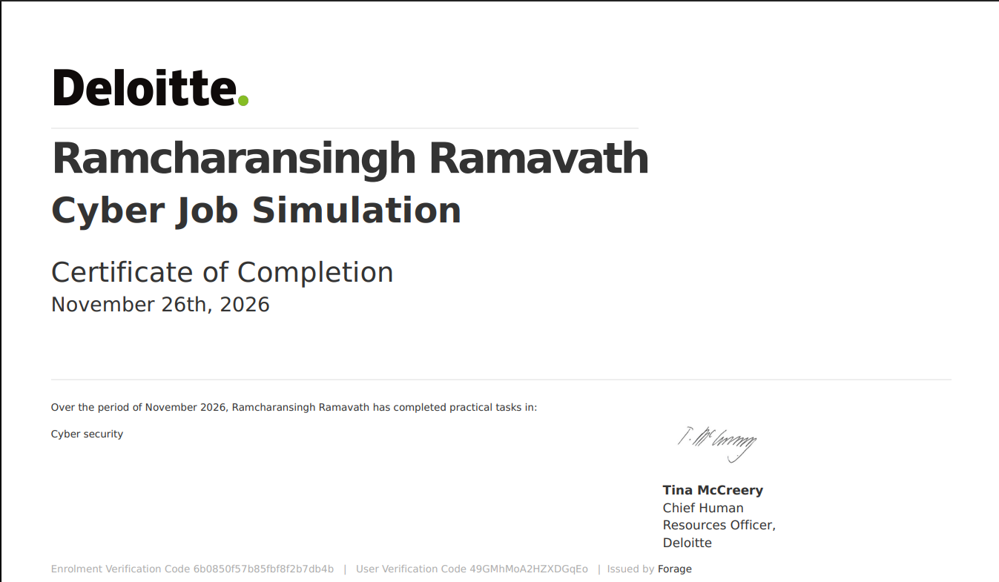

# 🛡️ Deloitte Australia – Cybersecurity Job Simulation

  
  
  

  <b>Cybersecurity Investigation | Web Log Analysis | Threat Detection</b>

## 📌 Project Overview

Successfully completed the **Deloitte Australia Cybersecurity Job Simulation** through Forage.

This simulation focused on investigating a potential security incident involving the exposure of private company information. The task involved analyzing web activity logs, identifying suspicious user behavior, and understanding the security of an internal manufacturing status dashboard.

## 🎯 Task Completed – Cybersecurity Investigation

### 🔍 Investigation Activities

- Analyzed web activity logs to identify unusual request patterns.
- Examined user IDs, IP addresses, HTTP requests, and access behavior.
- Investigated the accessibility of the manufacturing status dashboard.
- Identified suspicious automated API requests across four factory locations.
- Examined internal network access and VPN-based remote connectivity.
- Evaluated the difference between normal dashboard browsing and automated API activity.

### 🚨 Key Security Finding

Identified a suspicious user account generating recurring hourly API requests to manufacturing status endpoints across all four factories.

The activity was unusual because:
- Requests occurred at consistent hourly intervals.
- API status checks were performed without normal dashboard page-resource requests.
- The behavior differed from regular human dashboard browsing.

**Assessment:** The activity was consistent with automated access to manufacturing status information and warranted further investigation.

### 🌐 Network Security Assessment

- The manufacturing dashboard was hosted on the company's internal intranet.
- It was not directly accessible from the public internet.
- Remote access was provided through VPN tunnelling into the private network.

## 📸 Project Screenshots

  

  

## 🏆 Certificate of Completion

  

## 🧠 Skills Demonstrated

| Category | Skills |
|---|---|
| Cybersecurity | Security Investigation, Threat Detection |
| Log Analysis | Web Activity Logs, HTTP Request Analysis |
| Network Security | Internal Networks, VPN Tunnelling |
| API Security | API Request Monitoring, Access Pattern Analysis |
| Investigation | Suspicious Behavior Identification, Security Assessment |

## 📚 Key Learnings

- Understanding web server activity and request patterns.
- Identifying unusual and automated user activity.
- Analyzing API access behavior to investigate potential security risks.
- Understanding intranet security and VPN-based remote access.
- Applying structured log analysis to cybersecurity investigations.

## 🛠️ Tools & Technologies

`Web Activity Logs` `HTTP Requests` `API Analysis` `Network Security` `VPN` `Cybersecurity Investigation`

## 👨‍💻 Author

**Ramcharan Singh Ramavath**

Cybersecurity & GRC Analyst | VAPT | SOC

- LinkedIn: [Connect with me](https://www.linkedin.com/in/ramavath-ramcharan-singh29/)
- GitHub: [RamcharanSinghRamavath](https://github.com/RamcharanSinghRamavath)

---

  <b>Completed through Deloitte Australia Cybersecurity Job Simulation – Forage</b>

